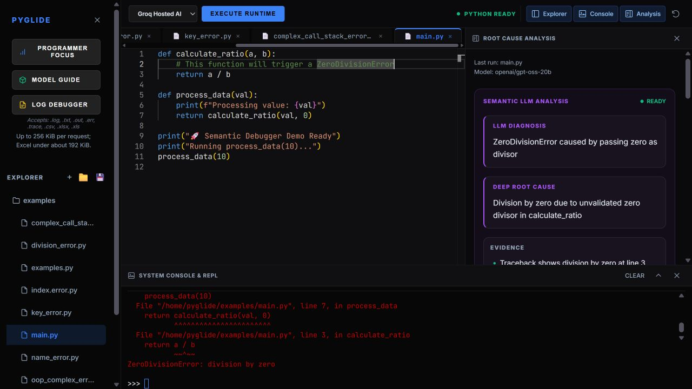

<p align="center">
  
</p>

<h1 align="center">PyGlide</h1>

<p align="center">Write Python. Run it in your browser. Understand what went wrong.</p>

<p align="center">
  <a href="https://pyglide-web.onrender.com/">Open the live IDE</a> ·
  <a href="#run-locally">Run locally</a> ·
  <a href="DEPLOYMENT.md">Deployment guide</a>
</p>



PyGlide is a browser-based Python IDE with an interactive console, a multi-file workspace and AI-assisted root cause analysis (RCA). Run a program or upload a log to explore its traceback, likely cause, related bug patterns and suggested repairs.

The hosted version uses **Groq** for AI feedback. You can also run PyGlide locally with **Ollama**. Optional **Sarvam** translation makes generated explanations available in Indian languages.

## What you can do

| Area | Features |
| --- | --- |
| **Editor** | Monaco syntax highlighting, Python completions, current-file names and editable code templates. |
| **Python runtime** | Browser execution through Pyodide, an interactive REPL, `input()`, console output and Stop. |
| **Workspace** | Files and folders, multiple tabs, sibling imports, relative data files and ZIP downloads. |
| **Root cause analysis** | Traceback frames, candidate-frame ranking, historical bug matching, streamed AI feedback, fix plans and prevention checks. |
| **Log debugger** | Debug `.log`, `.txt`, `.out`, `.err`, `.trace`, `.csv`, `.xlsx` and `.xls` uploads. |
| **Language support** | Translate completed RCA reports through Sarvam; keep the English report available. |
| **Interface** | Resizable Explorer, Console and Analysis panels, saved layout preferences, dark scrollbars, Programmer Focus statistics and a Model Guide. |

## Try the hosted IDE

1. Open [PyGlide](https://pyglide-web.onrender.com/) and wait for **PYTHON READY**.
2. Create a Python file, or open an example from the Explorer.
3. Click **EXECUTE RUNTIME**. Enter answers in the console when the program asks for input.
4. If the program fails, inspect the **Root Cause Analysis** panel. After feedback finishes, choose a language and select **CONVERT** to translate it.

Try both interactive input and an intentional error:

```python
name = input("Your name: ")
print(f"Hello, {name}!")
print(1 / 0)  # Opens analysis for a ZeroDivisionError.
```

The bundled scripts in [`examples/`](examples/) intentionally demonstrate Python errors. **LOG DEBUGGER** lets you inspect an existing log without executing its original program.

## Run locally

Use **Node.js 22.12+**, npm and **Python 3.12**. Ollama is needed only when you choose local AI feedback. Internet access is needed for CDN assets, the initial Python runtime download and cloud AI or translation requests.

### 1. Install dependencies

```bash
git clone https://github.com/parthpathak719/PyGlide.git
cd PyGlide
npm ci
python -m venv .venv
```

Activate the Python environment for your shell:

| Shell | Command |
| --- | --- |
| Windows PowerShell | `.\.venv\Scripts\Activate.ps1` |
| macOS / Linux | `source .venv/bin/activate` |

Then install the lightweight backend dependencies, including Excel log readers:

```bash
python -m pip install -r backend/requirements-hosted.txt
```

This setup uses the default hash embedder and works with either AI provider. Keep `PYGLIDE_HOSTED="false"` for local use. Optional MiniLM setup is covered in the configuration reference below.

### 2. Create your configuration files

Copy the two templates to their matching locations:

```bash
cp .env.example .env
cp backend/.env.example backend/.env
```

The root [`.env.example`](.env.example) contains **public frontend settings**. [`backend/.env.example`](backend/.env.example) contains **backend settings and private credentials**. Fill in only the services you use; keep real `.env` files out of Git. Existing system environment variables take priority over `backend/.env`.

### 3. Choose an AI provider

**Ollama — default local setup**

Keep the templates' `ollama` provider values and install [Ollama](https://ollama.com/). Start its server in a separate terminal if its background service is not already running:

```bash
ollama serve
```

Back in your setup terminal, pull the default model:

```bash
ollama pull qwen2.5-coder:1.5b
```

The toolbar also offers `llama3.2:1b` and `phi4-mini:latest`; pull a model before selecting it. **Model Guide** lists the available choices.

**Groq — cloud alternative**

Add these settings to the indicated files. Your computer does not need to run a local model.

| File | Setting |
| --- | --- |
| Root `.env` | `VITE_LLM_PROVIDER="groq"` |
| `backend/.env` | `LLM_PROVIDER="groq"` and `GROQ_API_KEY="your_groq_api_key"` |

Both templates default to `openai/gpt-oss-20b`. If you change it, keep `VITE_GROQ_MODEL` and `GROQ_MODEL` in sync.

### 4. Start the API and frontend

In a terminal with your Python environment activated, run this from the project root:

```bash
python -m uvicorn main:app --app-dir backend --host 127.0.0.1 --port 8000
```

In another terminal, also from the project root:

```bash
npm run dev
```

Open [localhost:3000](http://localhost:3000). The API runs at [localhost:8000](http://localhost:8000); its [health check](http://localhost:8000/health) and [interactive API reference](http://localhost:8000/docs) are available there.

## Working in the editor

### Completions and shortcuts

Type `pri` to see `print` and other matching suggestions. Completion covers Python built-ins, keywords and names declared in the current file. Templates include functions, classes, loops, conditionals and `try` / `except` blocks.

| Action | Shortcut |
| --- | --- |
| Open suggestions | `Ctrl+Space` |
| Navigate suggestions | `↑` / `↓` |
| Accept / dismiss a suggestion | `Tab` or `Enter` / `Esc` |
| Toggle Explorer | `Ctrl+B` |
| Toggle Console | `Ctrl+J` |
| Toggle Analysis | `Ctrl+Alt+A` |

Use Command for the panel shortcuts on macOS. Normal Tab indentation is preserved when suggestions are closed. Completions run in the browser without AI calls. This basic version does not infer object types, imported-library members or names from other files; suggestions are suppressed in comments, strings and member-access contexts.

### Panels and saved work

Drag the Explorer's right edge, Analysis's left edge or Console's top edge to resize a panel. Focus an edge and use the arrow keys to adjust it, or double-click to reset its size. The console chevron maximizes or restores it; **Reset panel layout** restores all defaults.

Closing a panel hides it and preserves its contents. Analysis stays available through edits and file switches until the next run; a successful run clears the previous analysis. Files, open tabs, layout preferences and Programmer Focus statistics are saved in the current browser. Use **Download Workspace** to export a ZIP.

Each run starts a fresh Python worker and copies the workspace into `/home/pyglide`, using the active file's folder as its working directory. This supports sibling imports, nested packages and relative data-file reads. REPL commands share state until the next Run or Stop. Python packages must be compatible with Pyodide.

## How the pieces fit together

| Component | Responsibility |
| --- | --- |
| **Browser** | React interface, Monaco editor, Pyodide worker, Xterm.js console and local workspace storage. A service worker routes interactive input to the correct tab. |
| **FastAPI backend** | Parses tracebacks and logs, retrieves related bug records, builds RCA, streams AI feedback and handles translation. |
| **AI provider** | Groq for cloud feedback, or Ollama for local feedback. Code/error context is sent to the selected provider through the backend. |
| **Example storage** | Source files ship in Git. Local deletion removes disk files; hosted deletion writes persistent records to Supabase. |

Python entered in the active IDE executes in the browser. The backend receives source/error context for debugging and uploaded logs; Sarvam receives report text when you request translation. Workspace files stay in browser storage and do not sync between devices.

Retrieval starts with **eight bundled bug records** and uses deterministic hash embeddings by default. Optional MiniLM support is available locally. Generated indexes are ignored by Git and can be rebuilt from the bundled records. AI failures retain deterministic feedback rather than blocking the editor.

## Host it with your computer off

The free deployment uses the same repository on `main`:

| Part | Service |
| --- | --- |
| Frontend | Render Static Site |
| API | Render Free Web Service |
| AI feedback | Groq Free |
| Persistent shared-example deletions | Supabase Free |
| Optional report translation | Sarvam, subject to its available credits |

Follow **[DEPLOYMENT.md](DEPLOYMENT.md)** for service settings, environment variables, the optional Render Blueprint and deployment checks. The hosted backend uses lightweight dependencies and disables server-side code execution and dataset ingestion. Visitors run Python in their own browsers, so your computer and Ollama can stay off.

Free services have limits: [Render](https://render.com/docs/free) sleeps after idle periods, [Groq](https://console.groq.com/docs/rate-limits) applies request/token quotas, and [Supabase](https://supabase.com/docs/guides/platform/free-project-pausing) may pause low-activity projects. These services suit a project/demo within their free quotas. Loading shared examples queries Supabase; running browser Python alone does not. See the deployment guide for current limits and recovery steps.

## Configuration reference

<details>
<summary><strong>Environment variables</strong></summary>

**Root `.env` — public values included in the frontend build**

| Variable | Purpose |
| --- | --- |
| `VITE_API_URL` | Backend origin; defaults to `http://localhost:8000`. |
| `VITE_LLM_PROVIDER` | `ollama` or `groq`; match the backend provider. |
| `VITE_GROQ_MODEL` | Groq model displayed in the IDE; match `GROQ_MODEL`. |

**`backend/.env` — backend configuration and secrets**

| Variable | Purpose |
| --- | --- |
| `LLM_PROVIDER` | `ollama` locally, or `groq` with a Groq key. |
| `GROQ_API_KEY` / `GROQ_MODEL` | Groq credentials and model selection. |
| `SARVAM_API_KEY` | Enables optional RCA translation. |
| `EXAMPLE_DELETE_PASSWORD` | Authorizes deletion of protected/shared examples. |
| `SUPABASE_URL` / `SUPABASE_SERVICE_ROLE_KEY` | Persist hosted example-deletion records. Accepts a backend secret key (`sb_secret_...`) or legacy `service_role` JWT. |
| `SUPABASE_PASSWORD` | Optional database-password reference; the app does not read it. It is separate from the API key above. |
| `PYGLIDE_HOSTED` | `false` locally; `true` enables hosted request limits and disables server execution/imports. |
| `CORS_ORIGINS` | Comma-separated allowed frontend origins. Use the actual frontend HTTPS origin on Render. |
| `SEMANTIC_DEBUGGER_EMBEDDER` | `hash` by default; optional `minilm` uses locally cached model weights. |

Keep API keys, Supabase credentials and the deletion password in the backend only. Frontend environment changes require restarting Vite locally or rebuilding the hosted frontend; backend changes require restarting/redeploying the API.

For optional MiniLM retrieval, install `backend/requirements.txt` in the same Python environment, cache `all-MiniLM-L6-v2` locally, set `SEMANTIC_DEBUGGER_EMBEDDER="minilm"` and restart the backend. If its dependencies or cached weights are unavailable, the embedder falls back to hashing. On Windows, a short virtual-environment path such as `C:\venvs\pyglide` helps avoid long-path installation errors.

</details>

<details>
<summary><strong>Translation, example deletion and hosted limits</strong></summary>

- **Translation:** set `SARVAM_API_KEY` in the backend. Completed English reports can be translated into Hindi, Bengali, Gujarati, Kannada, Malayalam, Marathi, Odia, Punjabi, Tamil, Telugu, Urdu and other supported languages. Reports are limited to 20,000 characters and translated in ordered chunks of at most 2,000. A failed chunk returns an error and keeps the English RCA available.
- **Ordinary workspace files:** edits and deletions affect the current browser's saved workspace.
- **Local examples:** deleting a predefined example requires `EXAMPLE_DELETE_PASSWORD` and permanently removes its file from `examples/`.
- **Hosted examples:** password-authorized deletions write Supabase records and hide those examples for all visitors across deployments. Supabase stores deletion records, while example source content remains in Git. Without Supabase, shared deletion is refused. Set up the table with [`supabase/schema.sql`](supabase/schema.sql); restoration is described in the deployment guide.
- **Hosted requests:** the backend caps request bodies at 256 KiB and shares a limit of eight AI, translation or example-deletion requests per minute. Groq's own quotas also apply. Excel uploads are base64-encoded; keep workbooks under about 192 KiB so the full JSON request fits the limit.

</details>

## Development reference

<details>
<summary><strong>Project map</strong></summary>

```text
index.html                    Active IDE and inline React application
src/
  monaco-runtime.js           Bundled Monaco setup and worker
  python-completion.js        Python completions and snippets
  font-metrics.js             Refreshes measurements after web fonts load
  workspace.css               Panel layout, responsive styles and scrollbars
pyworker.js                   Pyodide execution, workspace files and REPL
sw.js                         Per-tab interactive-input routing
backend/
  main.py                     FastAPI endpoints and hosted request limits
  settings.py                 Backend environment loading
  parser/                     Traceback and uploaded-log parsing
  rca/                        Root cause analysis
  embeddings/                 Hash / optional MiniLM embeddings
  ingestion/                  Bundled records and BugsInPy ingestion
  vector_db/                  Local vector storage and search
  llm/                        Groq / Ollama feedback
  sarvam_translate.py         Report translation
  example_files.py            Example listing and protected deletion
  example_deletions.py        Supabase deletion persistence
  tests/                      Backend tests
tests/                        Frontend and browser-runtime contract tests
examples/                     Intentionally failing Python demos
public/                       Favicon assets
supabase/schema.sql           Hosted deletion table and access policy
render.yaml                   Optional Render deployment Blueprint
DEPLOYMENT.md                 Full hosting guide
```

The active Vite entry is **`index.html`**. `src/App.jsx`, `src/main.jsx` and their related components are a separate React implementation; they are not the current IDE entry point.

</details>

<details>
<summary><strong>API endpoints</strong></summary>

Use the backend's `/docs` page for request schemas and interactive examples.

| Method | Route | Purpose |
| --- | --- | --- |
| GET | `/health` | API health, provider and hosted mode. |
| GET | `/workspace/examples` | Available bundled examples. |
| POST | `/workspace/examples/delete` | Protected example deletion. |
| POST | `/rca` | Analyze a supplied Python traceback and code. |
| POST | `/log-debug` | Extract failure context and RCA from a log payload. |
| POST | `/stream-feedback` | Stream Groq or Ollama feedback. |
| POST | `/translate-feedback` | Translate generated RCA through Sarvam. |
| GET | `/similar-bugs` | Retrieve related bug records. |
| POST | `/semantic-search` | Search bug records using error/code context. |
| POST | `/generate-embedding` | Generate an embedding for supplied text. |
| GET | `/embeddings` | Inspect stored vector records. |
| POST | `/execute` | Local API subprocess execution; disabled in hosted mode. |
| POST | `/stop` | Stop local API execution; disabled in hosted mode. |
| POST | `/ingest-bugsinpy` | Import a local dataset; disabled in hosted mode. |

</details>

### Checks

From the project root, with frontend dependencies installed and your backend Python environment activated:

```bash
npm test
npm run build
python -m unittest discover -s backend/tests -v
```

The tests cover workspace persistence, completions, font loading, runtime startup, per-tab input routing, provider failures, translation and protected deletion. Backend tests use mocked cloud responses and temporary example copies. For a deployment, also check actual execution, `input()`, RCA and log uploads as described in [DEPLOYMENT.md](DEPLOYMENT.md#4-connect-the-two-services).

## Troubleshooting

| Symptom | What to check |
| --- | --- |
| **Loading Python / Loading Engine** stays visible | Allow the initial runtime download. If startup fails, use **RETRY RUNTIME** and check connectivity to the runtime/CDN assets. |
| Hosted examples or AI are temporarily unavailable | The free backend may be waking up. Wait about a minute and retry; inspect `/health` if it persists. |
| **Example storage is unavailable** | Check whether Supabase is paused and resume it in its dashboard. Verify the backend project URL, secret key and deletion table. |
| Local API connection fails | Start the backend and match `VITE_API_URL` with its URL. Check `CORS_ORIGINS` and restart Vite after changing frontend settings. |
| Ollama feedback falls back | Check that Ollama is running and that `ollama list` includes the selected model. |
| Groq reports a quota or provider error | Check the backend key, configured model and account limits. Basic debugging remains available. |
| Translation fails | Check the backend Sarvam key and available credits. A system environment variable can override the key in `backend/.env`. |
| A Python import fails | Workspace modules must exist in the browser workspace; third-party packages must be available for Pyodide. Installing a backend package does not install it in browser Python. |
| Local dependencies or ports fail | Use the same activated Python environment for installation and startup. Vite defaults to port `3000`; update its configuration and allowed origins together if needed. |
